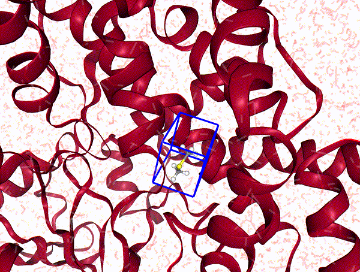

# Evolutionary low-precision QM/MM
> [](https://bestquark.github.io/evolutionary-qmmm/) &nbsp;&nbsp;&nbsp; 🔑 **Password**: `gordonbell2026`


This repository contains code for simulating quantum systems using mixed-precision arithmetic, embedded in a classical environment.
The main idea is to use this technique for speeding up free-energy calculations (e.g. FEP) while maintaining accuracy.

<p style="text-align:center;">

</p>


## Installation

Make sure you have an API key for OpenEvolve and have it set in your environment:
```bash
export OPENAI_API_KEY="your_key_here"  
```

If you are only running only the QM simulations, clone the repository and sync the environment:

```bash
git clone https://github.com/bestquark/evolutionary-qmmm.git
cd evolutionary-qmmm
uv sync
uv run pre-commit install
```

Configure the number of GPUs to use with:
```bash
source ./config_gpus.sh
echo "$CUDA_VISIBLE_DEVICES" # Check the GPUs assigned
```

## Usage

### GPU-Accelerated Quantum Chemistry

The repository now includes GPU-accelerated ground state calculations using `gpu4pyscf`. This enables fast QM calculations with optional QMMM external potentials:

```python
from src.qm import create_molecule, compute_ground_state

# Create molecule
mol = create_molecule(atoms="H 0 0 0; H 0 0 0.74", basis="6-31g")

# Compute ground state with HF, DFT, or MP2
results = compute_ground_state(mol, method="HF")
print(f"Energy: {results['energy']:.6f} Hartree")
```


### Code Evolution

Code evolution takes place in the `code_evolution/` directory.

To evolve a program, run:
```bash
uv run python -m code_evolution.openevolve-run code_evolution/initial_program.py code_evolution/evaluator.py --config code_evolution/config.yaml --iterations 5
```