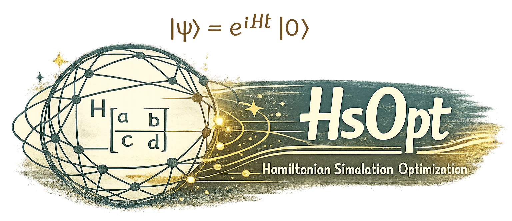

<p align="center">
  
</p>

# HSOpt

HSOpt uses an AI mutation loop to reduce the logical $T$-gate cost of
product-formula quantum phase estimation while preserving a fixed energy
accuracy target. Every candidate is evaluated by constructing and
diagonalizing the compiled Clifford+$T$ unitary; analytical product-formula
bounds are not used as the acceptance test.

The repository contains one benchmark tree, [`experiments/`](experiments/),
and one plotting-source tree, [`plots/`](plots/). Raw campaigns, databases,
Hamiltonian collections, caches, scheduler logs, and agent transcripts stay
outside the Git checkout.

The **best released ELOTE policy** is in
[`experiments/elote_search/results/elote115/`](experiments/elote_search/results/elote115/README.md),
including its sealed training parameters, validation results and provenance.

Follow [Reproduce the paper workflow](docs/reproduce.md) from a fresh clone:
acquire and verify inputs, inspect Hamiltonians, generate loose/tight policies,
set up OpenShell, run mutations, and reproduce plots. Keep generated files in
one external `hsopt_workdir/`.

## Quick start

Install [`uv`](https://docs.astral.sh/uv/getting-started/installation/), then
evaluate the included H2 policies with Python 3.12. Linux installs the pinned
CUDA-Q synthesis dependency automatically. On Apple silicon, first follow the
[CUDA-Q CPU installation](docs/synthesis.md#apple-silicon) after cloning:

```bash
git clone https://github.com/bestquark/hsopt.git
cd hsopt
uv sync --locked --python 3.12
uv run python cli/tests/fixtures/abs_energy_h2/evaluate.py --backend numpy
uv run python cli/tests/fixtures/diff_energy_h2_bond_stretch/evaluate.py \
  --error-contract error_cancellation --backend numpy
```

Each command prints a JSON result. Look for `passes_chemical_accuracy: true`,
the energy error, and `confidence_adjusted_t_count` (the optimization score).
These commands evaluate the supplied policies; they do not invoke an AI agent.

To try a policy change, copy the fixture policy to an external directory and
pass it with `--policy-file`:

```bash
mkdir -p ../hsopt-demo
cp cli/tests/fixtures/abs_energy_h2/initial_pf.py ../hsopt-demo/candidate.py
# Edit ../hsopt-demo/candidate.py, then evaluate it:
uv run python cli/tests/fixtures/abs_energy_h2/evaluate.py \
  --backend numpy --policy-file ../hsopt-demo/candidate.py
```

The [product-formula interface](#product-formula-policy) below describes the
editable policy. Automated mutations additionally require the
[OpenShell agent setup](#openshell--opencode-mutation-agent). Full paper
campaigns require separately prepared inputs and suitable compute resources;
large HamLib archives are downloaded explicitly. Reaction Hamiltonians and
metadata are generated from the 21 fixed species definitions using the optional
`chemistry` dependencies; see the [reaction-generation recipe](experiments/diff_energy/inputs/README.md).
The corrected two-electron conversion is the default. Historical replay uses
an explicit separate mode, and corrected inputs require fresh calibration and
campaign results. Historical run outputs and site deployment state remain external.

GitHub Actions checks installation, every command's `--help`, the two CPU
examples, and the test suite on macOS and Linux with Python 3.12.

Rotation compilation uses CUDA-Q's CPU Ross--Selinger implementation with seed
0 and the policy's requested operator-norm tolerance. Results record the compiler
and search settings under `rotation_synthesis`. See [synthesis and result provenance](docs/synthesis.md).

## Objective

For each physical Hamiltonian,

```math
H=c_0I+\sum_j h_jP_j,
\qquad
\lambda=\sum_j |h_j|,
```

HSOpt uses the explicit QPE encoding

```math
U=\exp\left(+i\frac{H-c_0I}{\lambda}\right).
```

Equivalently, the product formula simulates the physical Hamiltonian for
$t=1/\lambda$ Hartree$^{-1}$. Since
$\lVert H-c_0I\rVert\leq\lambda$, every exact encoded eigenphase lies in
$[-1,1]$ radians and cannot wrap across $\pm\pi$. The principal phase is
decoded without consulting the exact answer:

```math
E_{\mathrm{Ha}}=c_0+\lambda\phi.
```

The lowest exact HF-accessible QPE energy is cached once to score candidates.
The exact ground energy is retained separately as a diagnostic and for the
existing Reiher baseline calibration. A candidate may change the product formula and rotation-synthesis parameters, but not this
encoding, the Hamiltonian, or the electron sector.

The evaluator diagonalizes the compiled $U_{\mathrm{PF}}$ and selects the
lowest decoded energy with numerically resolved HF weight $p_{\mathrm{HF}}$.
Its simulation error is the difference from the exact HF-accessible energy,
using the same determinant and peak threshold. This tests QPE dynamics rather
than state-preparation quality. After measuring its compiled-unitary systematic error
$\epsilon_{\mathrm{sys}}$, the remaining chemical-accuracy budget is assigned
to QPE:

```math
\epsilon_{\mathrm{QPE}}
=
\epsilon_{\mathrm{chem}}-\epsilon_{\mathrm{sys}}.
```

Using the rigorous phase-estimation row of the Reiher *et al.* supplement, one
QPE attempt uses

```math
M_{\mathrm{QPE}}
=
\left\lceil
\frac{8\pi}{t\epsilon_{\mathrm{QPE}}}
\right\rceil
```

full-evolution queries and succeeds with probability at least
$p_{\mathrm{HF}}/2$. The number of independent attempts required for 95%
confidence is therefore

```math
R_{95}
=
\left\lceil
\frac{\log(0.05)}{\log\left(1-p_{\mathrm{HF}}/2\right)}
\right\rceil,
\qquad
T_{95}=R_{95}M_{\mathrm{QPE}}T_U,
```

where $T_U$ is the directly synthesized CUDA-Q $T$ count of one compiled
product-formula evolution. A molecular candidate is feasible when

$$
\left|E^{\mathrm{PF}}-E^{\mathrm{exact}}\right|
< 1\ \mathrm{kcal}\,\mathrm{mol}^{-1}.
$$

Among feasible candidates, HSOpt minimizes $T_{95}$.
Reports retain $T_U$, $M_{\mathrm{QPE}}$, $R_{95}$, and their full product.

For a reaction, each unique species is evaluated independently and the signed
reaction energy is formed classically. The remaining QPE energy budget is
allocated so every species contributes an equal worst-case absolute error
after its stoichiometric coefficient. The five-percent failure budget is shared
equally across unique species, giving at least 95% joint confidence by the
union bound. Stoichiometric coefficients affect the energy difference but do
not duplicate circuits. The reaction objective is the sum of the full
confidence-adjusted species QPE costs.

Reaction optimization is deliberately split into two independent contracts.
The conservative `individual_errors` lane requires

$$
\sum_s \left|\nu_s\left(\widetilde E_s-E_s\right)\right|
< \varepsilon_{\mathrm{chem}},
$$

while the `error_cancellation` lane requires

$$
\left|\sum_s \nu_s\left(\widetilde E_s-E_s\right)\right|
< \varepsilon_{\mathrm{chem}}.
$$

Every evaluation records both quantities. The selected contract is sealed in
the lane manifest and queue task ID and alone controls feasibility and
acceptance; mutations, incumbents, exports, and plots are never pooled across
the two contracts.

## Product-formula policy

The agent edits a small executable `ProductFormula` class, not the baseline's
derivation record. Its three scientific hooks are:

```python
class ProductFormula:
    def repetitions(self): ...
    def build_step(self, terms, step_time): ...
    def synthesis_epsilon(self, term, angle): ...
```

`build_step()` returns the ordered `(Pauli term, angle)` rotations for one
stationary step. That returned schedule is authoritative: the evaluator can
apply it with ideal rotations to construct the exact mathematical PF step or
compile the same rotations with CUDA-Q. No `formula_order = 2` constraint
is imposed. The generated baseline implements PF2/Strang, while mutations may
replace its recurrence with PF1, a higher-order composition, grouping, or
another deterministic stationary product formula.

The evaluator infers standard PF1/PF2 and common ordering labels from the
actual schedule. Arbitrary recurrences are recorded as custom together with a
schedule checksum, so a stale human-written label cannot affect evaluation.
The full beta/Eq. (34) derivation, checksums, error allocation, and cached exact
energy remain in sealed campaign metadata outside the agent-editable file.
The `loose` initializer uses the rigorous Eq. (19) beta upper bound; the
`tight` initializer measures beta numerically against the cached exact energy
at the same 0.1 mHa reference error.

Each experiment family has one explicit evaluator entry point. Because
coefficient-heavy Hamiltonians and exact references remain external, invoke it
with the selected experiment directory and those sealed paths explicitly:

```bash
uv run python experiments/abs_energy/evaluate.py \
  experiments/abs_energy/<instance> \
  --problem /path/to/hamiltonian.json \
  --exact-reference /path/to/exact-reference.json \
  --baseline loose \
  --backend numpy --output /path/to/result.json
```

For optional BCH error estimates, select `--method bch`; see the short
[evaluation guide](cli/src/hsopt/evaluation/README.md). Production campaigns use exact scoring.

## Repository layout

```text
hsopt/
├── experiments/
│   ├── abs_energy/             82 definitions × two baseline policies
│   ├── diff_energy/            10 definitions × two baseline policies
│   ├── abs_protocol/           One shared PF across a molecular suite
│   ├── diff_protocol/          One shared PF across a reaction suite
│   └── generate_initial_pf.py  Loose/tight initializer for both families
├── plots/                      Publication-plot source code
├── skills/hsopt/               Compact agent instructions and references
└── cli/
    ├── src/hsopt/
    │   ├── campaign/           Scientific lane lifecycle, task records, and exports
    │   ├── data/               Dataset acquisition and reaction generation
    │   ├── evaluation/         Fixed compiled-unitary judge and diagnostics
    │   ├── sandbox/            OpenShell/OpenCode mutation boundary
    │   ├── view/               Mutation ledger and final-report views
    │   └── tgate_opt/          Generic mutation execution helpers
    └── tests/                  Scientific-contract tests and compact fixtures
```

`experiments/generate_initial_pf.py` exposes the compact `ProductFormula` and
emits the loose/tight starting policies. Calibration and provenance are in
`cli/src/hsopt/campaign/calibration.py`. Mutations edit the short emitted class:
repetitions, rotation schedule/angles, and per-rotation synthesis tolerance.

The learned protocol is **ELOTE — Error-Limited Optimized Trotter Evolution**;
HSOpt is the search framework. Its [explicit ingredients](docs/elote.md) include
Hamiltonian groups, splitting stages, repetitions, angles, mixed synthesis
precision and optional Clifford basis changes. A separately calibrated
`fermionic_nested` initializer implements orbital-disjoint nesting and symmetric
splitting for new shared-protocol experiments.

## Installation

HSOpt requires Python 3.12 or newer and uses
[`uv`](https://docs.astral.sh/uv/) for its environment:

```bash
git clone https://github.com/bestquark/hsopt.git
cd hsopt
uv sync --locked --python 3.12
```

Install the optional cuPyNumeric/Legate dependencies on a supported Linux
system:

```bash
uv sync --extra cupynumeric
```

## Run the compact checks

Evaluate the checked-in HamLib fixture on NumPy:

```bash
uv run python cli/tests/fixtures/abs_energy_h2/evaluate.py \
  --backend numpy
```

Evaluate the checked-in bond-stretch energy difference:

```bash
uv run python cli/tests/fixtures/diff_energy_h2_bond_stretch/evaluate.py \
  --error-contract error_cancellation \
  --backend numpy
```

Verify that an immutable iteration-0 policy still matches its sealed paper
calibration:

```bash
uv run hsopt-paper-baseline \
  cli/tests/fixtures/abs_energy_h2/hamiltonian.json \
  --backend numpy \
  --output /tmp/h2-paper-calibration.json

uv run python experiments/generate_initial_pf.py \
  cli/tests/fixtures/abs_energy_h2/hamiltonian.json \
  --output cli/tests/fixtures/abs_energy_h2/initial_pf.py \
  --calibration /tmp/h2-paper-calibration.json \
  --baseline loose \
  --check
```

These fixtures are development checks and therefore live under `cli/tests/`.
Under `experiments/abs_energy/`, every production Hamiltonian has its own
folder containing `instance.json`, `initial_pf_loose.py`, and
`initial_pf_tight.py`. Under
`experiments/diff_energy/`, every production reaction has its own folder
containing `definition.json` and the same two generated policy variants. Verify the
definitions against the compact source registries with:

```bash
uv run hsopt-layout --check
```

The large coefficient archives/caches and their materialized evaluator inputs
remain external datasets supplied to `hsopt-campaign`.

## Campaign lifecycle

Each lane prepares a fixed exact reference and a selected loose/tight baseline,
measures iteration 0, then proposes and evaluates mutations sequentially.
HSOpt records candidates, feedback, and acceptance decisions outside the checkout.

The backend-independent [runtime interface](docs/runtime.md) exchanges immutable
evaluation requests and result receipts. A runtime dispatches each request to
its chosen computer, then delivers the receipt to HSOpt. Delivery records the
result, applies the scientific acceptance rule, and wakes the lane to propose
its next mutation. Repeated delivery cannot duplicate a mutation or replace a
recorded result. A lane advances only after its pending evaluation completes.

Use one external workspace:

```text
hsopt_workdir/
    hsopt/       Source checkout
    data/        Prepared inputs and sealed references/calibrations
    runs/        Task ledger, candidates, results, decisions, and exports
    figures/     Generated plots
    runtime/     Dispatchers, machine configuration, environments, and hosting
```

Runtime code chooses machines, resources, batching, retries, and scheduling.
The repository provides scientific task snapshots and a single-task evaluator;
it contains no site-specific cluster submission adapter. Keep loose/tight
campaigns and reaction-error contracts separate. Existing trajectories retain
their frozen inputs, evaluator versions, and mutation protocol.

## Main commands

| Command | Purpose |
|---|---|
| `hsopt` / `hsopt-loop` | Initialize, reconcile, inspect, propose, or replay one sequential lane |
| `hsopt-baseline-drop` | Write the loose-to-tight iteration-0 T95 reduction per experiment |
| `hsopt-layout` | Verify or regenerate the checked-in 82-Hamiltonian/10-reaction directory layout |
| `hsopt-paper-baseline` | Prepare one loose or tight PF2 calibration and exact reference |
| `hsopt-paper-baseline-batch` | Build, run, and audit resumable calibration shards |
| `hsopt-campaign` | Prepare external inputs and initialize the complete lane grid |
| `hsopt-handoff` | Advance a lane, evaluate a task, or deliver a result and wake the next mutation |
| `hsopt-openshell` | Run the isolated OpenShell/OpenCode mutation adapter |
| `hsopt-export-exact` | Produce a strict checksummed export from a completed campaign |
| `hsopt-reports` | Compile summary and extended PDFs from a strict export |
| `hsopt-exact-parity` | Certify cross-backend CPU/A100 replay parity |
| `hsopt-view` | Export or serve the read-only mutation-history grid from a campaign directory |

Run any command with `--help` for its complete interface.

## Reports

First produce a normalized, checksummed export:

```bash
uv run hsopt-export-exact \
  --campaign-root "$HSOPT_DATA_ROOT/exact/production-gpu82-v1" \
  --family abs_energy \
  --output-dir "$HSOPT_DATA_ROOT/exact/final-abs-energy-export"
```

Then compile the paper reports:

```bash
uv run hsopt-reports \
  --family abs_energy \
  --export-dir "$HSOPT_DATA_ROOT/exact/final-abs-energy-export" \
  --output-dir "$HSOPT_DATA_ROOT/exact/final-abs-energy-reports"
```

The reporting gate emits two PDFs per Hamiltonian or reaction:

- a summary comparing the initial and final accepted policies;
- an extended table containing the initial policy and every mutation,
  acceptance decision, exact-reference error, product-formula settings, raw
  $T$ count, repetition factor, and confidence-adjusted $T_{95}$ cost.

LaTeX is used when available; ReportLab provides the portable renderer.

After the canonical campaign and optional validation replay finish, run the cross-backend
audit:

```bash
uv run hsopt-exact-parity \
  --cpu-campaign-root "$HSOPT_DATA_ROOT/exact/production-cpu82-replay-v1" \
  --gpu-campaign-root "$HSOPT_DATA_ROOT/exact/production-gpu82-v1" \
  --output "$HSOPT_DATA_ROOT/exact/production-gpu82-v1/cross_backend_audit.json" \
  --wait \
  --interval-seconds 60
```

The audit checks the complete lane grid, source and policy hashes, compiled
synthesis records, confidence-adjusted $T$ counts, policy settings,
acceptance trajectories, and energies. CPU and A100 energies are compared
within the configured numerical tolerance rather than requiring bitwise
floating-point identity.

## Plotting

Reusable code for publication figures belongs in [`plots/`](plots/). Plot
scripts should consume checksummed final exports or compact derived tables,
write generated figures to an explicit output directory, and keep raw campaign
data outside Git. Operational telemetry dashboards remain with their campaign
runners because they are part of execution rather than paper plotting.

## Agent skill

The repository keeps the `$hsopt` agent contract deliberately small under
`skills/hsopt/`. The installable evaluator and campaign runtime live separately
under `cli/src/hsopt/` and are installed by `uv sync`. The mutation sandbox receives
the compact skill, the fixed evaluator source, and only the selected lane's
read-only benchmark inputs; it does not receive the full campaign runtime.

Cloning the repository does not automatically activate the skill in an agent
environment. Install that agent-facing entry separately with:

```bash
npx skills add bestquark/hsopt --skill hsopt -y
```

The skill defines the immutable evaluator contract, permitted mutation
boundary, production ordering, and canonical-trace replay rules.

### Evaluation handoff

The agent reads the Hamiltonian and research context, optionally consults
literature, and proposes a change to `candidate.py`. The host snapshots the
proposal and fixed inputs into the evaluation queue, dispatches it to the
configured compute, and records the result and acceptance decision before the
next mutation. The current OpenShell mutation sandbox returns the proposal;
the host controller handles submission and result collection.

Dataset acquisition and preparation, the mutation skill, scientific scoring,
and plot scripts belong in this repository. Machine-specific environments,
connection settings, dispatchers, and hosted-dashboard state live in
the external workspace's `runtime/`. See the [runtime interface](docs/runtime.md)
for the request/result contract and a minimal local runtime.

### OpenShell + OpenCode mutation agent

The implementation and its tests have one explicit home:
[`cli/src/hsopt/sandbox/openshell.py`](cli/src/hsopt/sandbox/openshell.py) owns
host setup, disposable sandbox creation, OpenCode permissions, cleanup, and
tool/security telemetry; [`cli/README.md`](cli/README.md) documents that
boundary and every emitted audit file.

Use [OpenCode 2](https://opencode.ai/v2/docs/) in an
[OpenShell](https://docs.nvidia.com/openshell/) sandbox. The deployment installs
OpenShell on its host, supplies an image with `@opencode/cli@2.0.26`, and imports
its native inference provider profile. HSOpt defaults to Nemotron 3.5 Lightning
(`nvidia/nvidia/nemotron-3.5-lightning`), with automatic OpenCode compaction.
Set `HSOPT_MUTATION_MODEL`, `HSOPT_MODEL_CONTEXT_LIMIT`, and
`HSOPT_MODEL_OUTPUT_LIMIT` for your inference deployment's verified limits.
The default Lightning deployment has 128K total context and a 64K response
allowance, including reasoning; response space must leave room for input.
The OpenShell proxy keeps the real
credential on the host and substitutes it only at the approved inference endpoint.

```bash
openshell status
export HSOPT_SANDBOX_IMAGE="your-opencode2-image"
export HSOPT_SANDBOX_POLICY="/path/to/deployment/sandbox-policy.yaml"
# Import the hsopt-nvidia-native profile and load NVIDIA_API_KEY on the host.
uv run hsopt-openshell configure
```

Image builds, provider profiles, credentials, and deployment audit collectors
belong in the external `runtime/`. OpenCode runs with a private server using
`--standalone`; preparation and editing resume the same session. Native v2
permissions allow only the selected context reads, optional web research, the
HSOpt skill, and one candidate edit. The host verifies read/edit receipts before
returning a proposal.

Each mutation writes the raw `opencode.jsonl` and `openshell.log` alongside
redacted action and metric summaries. Rebuild those summaries without rerunning
the mutation with:

```bash
uv run hsopt-openshell audit --run-dir /path/to/mutation-run
```

The supervisor then creates one disposable sandbox per proposal, installs
`skills/hsopt/SKILL.md` as the sandbox's `hsopt` skill, exposes only the
isolated `candidate.py` mutation target plus bounded research tools, records
the OpenCode/OpenShell action logs, and deletes the sandbox. Set `HSOPT_AUDIT_COLLECTOR` to a deployment executable accepting the sandbox name
and mutation directory to collect full supervisor OCSF JSON before cleanup.

Run loose and tight campaigns with distinct supervisors, mutation pools,
queues, evaluator workers, and output roots. An evaluator worker must accept
exactly one baseline-tagged campaign root; deployments may coordinate access
to a shared accelerator with hardware locks, but must never round-robin tasks
from loose and tight queues through the same worker.

## Development

Run formatting, lint, and the complete test suite before publishing changes:

```bash
uv run ruff format --check cli/src cli/tests
uv run ruff check .
uv run pytest -q
```

See [`experiments/README.md`](experiments/README.md) for experiment-storage
rules and [`BRANCHES.md`](BRANCHES.md) for preserved historical branches.

## License

MIT License. See [`LICENSE`](LICENSE).
