# `trovolut.backends`

Backend registry and implementations.

## Architecture

```mermaid
flowchart TB
    subgraph core [Core Abstractions]
        BD[BaseDynamics]
        BM[BaseMetrics]
        BH[BaseHardware]
        PF[ProductFormula]
        C[Constraint / Group]
    end

    subgraph cpu [CPU Backend]
        CE[ExactEvolution]
        CT[TrotterEvolution]
        CQ[QDriftEvolution]
    end

    subgraph gpu [GPU Backend - cupynumeric]
        GE[ExactEvolution]
        GT[TrotterEvolution]
        GQ[QDriftEvolution]
        GP[LegateProfiler]
        GM[Metrics]
    end

    subgraph emulator [GPU MP Emulator]
        MPT[MPTrotterEvolution]
        MPQ[MPQDriftEvolution]
        MPTy[MPTaylorEvolution]
        MPP[MPPadeEvolution]
        EM[Metrics]
        HW[GPU / GPUCluster]
    end

    subgraph qpu [QPU Backend]
        QT[TrotterEvolution]
        QQ[QDriftEvolution]
    end

    subgraph filemaker [Filemaker]
        EV[Evaluator]
        CR[CPURunner]
        LR[LegateRunner]
        QR[QPURunner]
    end

    BD --> CE & CT & CQ
    BD --> GE & GT & GQ
    BD --> MPT & MPQ & MPTy & MPP
    BD --> QT & QQ
    PF --> CT & GT & MPT
    BM --> GM & EM
    BH --> HW
    C --> GM & EM
    EV --> CR & LR & QR
    LR --> GP
```



## API

::: trovolut.backends

## Usage

```python
import trovolut as trv

# List available backends
trv.backends.list_available()

# Check availability
trv.backends.is_available('gpu')

# Import dynamics methods directly
from trovolut.backends.cpu.dynamics import ExactEvolution, TrotterEvolution

# Import hardware-specific tools
from trovolut.backends.gpu.measure import Metrics
```

## Backends

### CPU
::: trovolut.backends.cpu

Provides dynamics methods (ExactEvolution, TrotterEvolution, QDriftEvolution) that work with any array backend.

### GPU  
::: trovolut.backends.gpu

Install: `uv pip install trovolut[gpu]` (Linux + NVIDIA only)

GPU-accelerated dynamics via cupynumeric + real GPU profiling via Legate/legion_prof.

### QPU
::: trovolut.backends.qpu

Install: `uv pip install trovolut[qpu]`

Provides QPU-specific tools for circuit compilation and hardware execution.

### GPU Mixed-Precision Emulator
::: trovolut.backends.gpu_mp_emulator

Install: `uv pip install trovolut[gpu-emulate]`

Provides mixed-precision emulation tools for studying quantization effects (FP64 → FP32 → FP16 → FP8 → FP4).

## Platform Support

| Backend | Linux | macOS | Windows |
|---------|-------|-------|---------|
| CPU | ✓ | ✓ | ✓ |
| GPU | ✓ | ✗ | ✗ |
| QPU | ✓ | ✓ | ✓ |
| GPU MP Emulator | ✓ | ✓ | ✓ |
