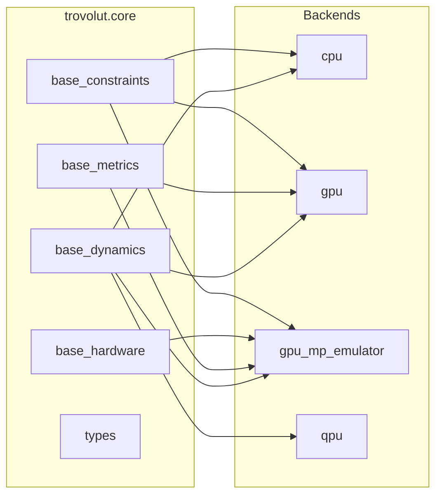

# `trovolut.core`

Base classes and types for backend implementations.

## Module Dependency Graph

## Base Classes

::: trovolut.core.BaseDynamics

::: trovolut.core.BaseMetrics

## Product Formulas

::: trovolut.core.ProductFormula

::: trovolut.core.LieTrotter

::: trovolut.core.SuzukiTrotter

::: trovolut.core.SuzukiHighOrder

## Hardware

::: trovolut.core.BaseHardware

::: trovolut.core.HardwareCluster

## Constraint System

::: trovolut.core.Constraint

::: trovolut.core.Group

## Types

::: trovolut.core.types
