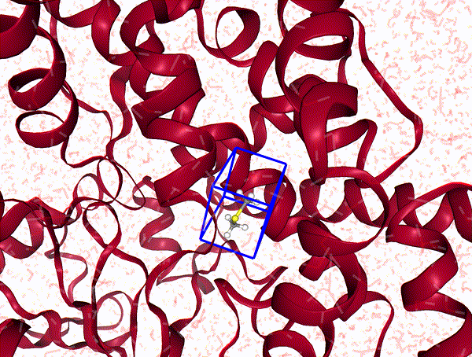

# Trovolut

This project provides tools for performing QM/MM simulations with mixed precision arithmetic, enabling efficient and accurate modeling of complex biological systems.





## Installation
```bash
uv sync
```


## Obtaining documentation
```bash
uv run mkdocs serve
```


